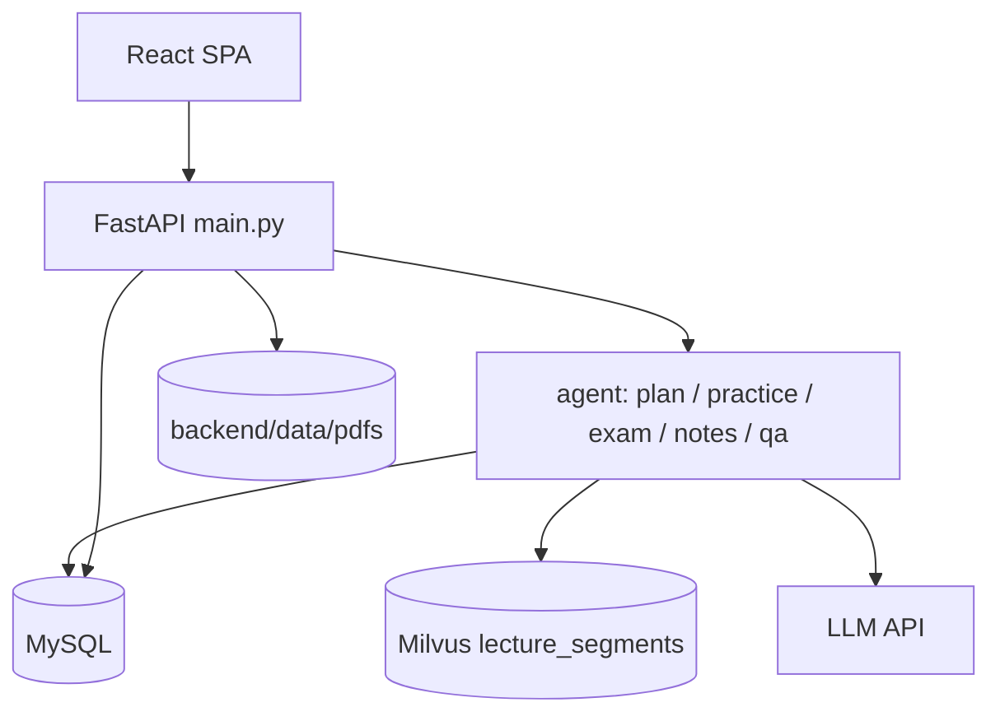
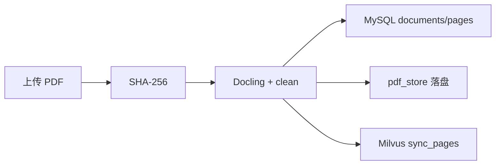
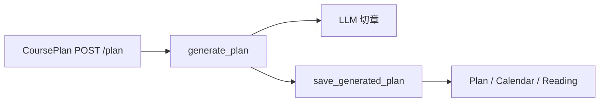
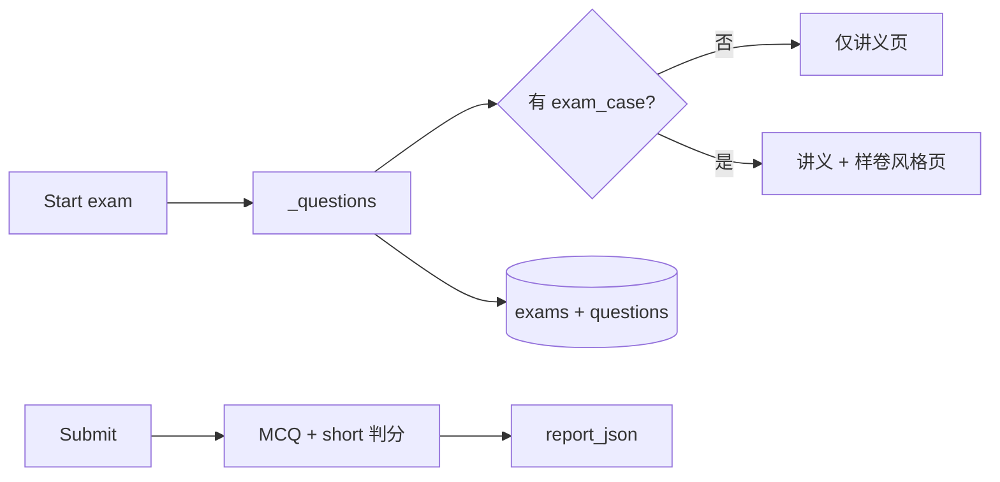
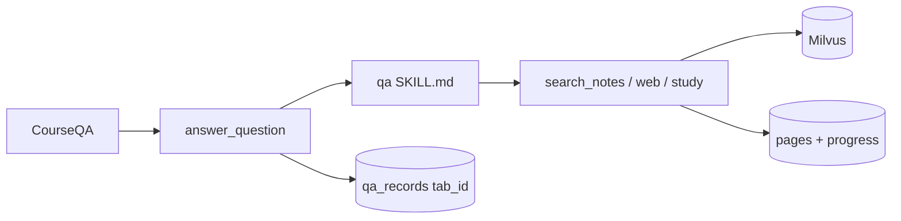

# CitePath-agent 完成报告

面向当前仓库已落地的功能：讲清楚各模块做什么、怎么串起来、数据落在哪。

## 1. 项目是什么

CitePath 是一门课一个学习闭环的 Agent 应用：

上传讲义 → 解析入库与向量化 → LLM 生成学习计划 → 阅读 / 练习 / 考试 / 笔记 / 多窗口问答 → 日历与报告。

| 层 | 技术 |
| --- | --- |
| 前端 | React 19 + TypeScript + Vite，自研路由 |
| 后端 | FastAPI + Uvicorn + Pydantic |
| 关系库 | MySQL 8.4（`backend/db/schema.sql` + 运行时 `ensure_*`） |
| 向量库 | Milvus（dense + BM25 + RRF），FastEmbed 多语 MiniLM，交叉编码器 rerank |
| PDF 入 | Docling（表格/公式）+ PyMuPDF 页数与清洗 |
| PDF 出 | PyMuPDF 渲染笔记 / cheatsheet |
| LLM | LangChain，OpenAI 兼容；`LLM_PROVIDER=hku\|deepseek` |

目录要点：`frontend/` SPA；`backend/main.py` 全量 API；`backend/agent/` 业务智能；`backend/db/` 持久化；`backend/ingest/` 解析；`backend/vector/` 检索；`backend/data/pdfs/` 原始 PDF。

## 2. 总览数据流

用户会话：cookie `citepath_session` → `users` / `login_sessions`。

## 3. 已完成模块（怎么做 + 数据流）

### 3.1 认证

- **前端**：`/login`、`/register`
- **后端**：`POST /api/register|login|logout`，`GET /api/me`
- **存储**：密码哈希；会话 cookie 14 天
- **数据流**：表单 → auth API → `users` / `login_sessions` → 后续请求 `Depends(current_user)`

### 3.2 课程与讲义上传

- **前端**：课程列表 / 新建编辑 / Course information
- **后端**：课程 CRUD；`POST .../documents`；`GET .../documents/{id}/file`；删除
- **具体步骤**：SHA-256 去重 → Docling 抽页 → `documents` + `pages` → 落盘 PDF → FastEmbed 写入 Milvus
- **文档 kind**：`lecture`（默认讲义）、`exam_case`（样卷）、`case_answer`（答案子文档，`parent_id` 指向样卷；`answer_mode`: `none|in_case|file`）

### 3.3 学习计划 Plan

- **前端**：`/courses/:id/plan` — 日期窗口、备注、选文档；任务行：Open / Practice / Exam / Reports / Done
- **后端**：`GET/POST .../plan`，`POST .../plan/tasks/{id}/complete`
- **具体做法**：`agent/plan.generate_plan` 按讲义页切 chapter/concept/page；`assemble_plan` 排进起止日期；写入 `study_plans.plan_json` 与 `plan_chapters` / `plan_concepts` / `plan_chapter_pages`
- **阅读任务**：`/courses/:id/read` 用原始 PDF 文件 API 内嵌预览，Done 调 complete

### 3.4 练习 Practice

- **前端**：练习入口、直播答题页、章节报告
- **后端**：`POST .../chapters/{id}/practice`（可带偏好）、open、answer、reports
- **具体做法**：`agent/practice` 按 concept 进度自适应出题（MCQ / short）；`grading/score` 判分；错题可 LLM 讲解
- **存储**：`practice_sessions`、`practice_questions`、`practice_answers`、`concept_progress`

### 3.5 考试 Exam + 样卷 Exam cases

- **样卷 UI**：课程 tab `cases` — 上传样卷 / 可选答案
- **考试 UI**：Plan 上 Exam → `/exams/:courseId/:examId`；交卷报告页
- **出题**：`agent/exam` 每 concept 约 1 MCQ + 1 short；**无样卷时**只用章节讲义页（旧逻辑）；有样卷时把 case pages 当风格参考，答案文本可参与 short 判分
- **存储**：`exams`、`exam_questions`、`exam_answers`、`exam_drafts`

### 3.6 笔记 Notes / Cheatsheet

- **前端**：tab `notes` — 选讲义、模式 `notes|cheatsheet`、纸张 a4/a5/letter
- **后端**：`POST .../notes` 直接返回 PDF 附件（不落库）
- **具体做法**：读可用页 → LLM 出 JSON 大纲 → PyMuPDF 排版（cheatsheet 更密；字体回退避免 `?`）

### 3.7 问答 Q&A（多窗口）

- **前端**：tab `qa` — 左侧 chat 列表（新建/删除）、右侧对话自动滚底、Enter 发送、PDF chip（空选 = 闲聊）
- **后端**：`GET/POST .../questions`，`DELETE .../questions/tabs/{tab_id}`
- **具体做法**：`load_skill("qa")` 系统提示；工具循环：`search_notes`（Milvus）、`search_web`、学习状态工具；结果写入 `qa_records`（`tab_id` / `tab_title` / `origin` / `cited_pages`）
- **徽章含义**：`chat` → Noted（闲聊）；材料命中 / web / account / refused 各有标签

### 3.8 日历 Calendar

- **前端**：`/calendar` 聚合各课 plan 任务日期；可完成任务、按课过滤
- **后端**：无独立 calendar API，数据来自前端已加载的 plan

### 3.9 报告与掌握度

- 练习：`GET .../chapters/{id}/reports`
- 考试：`exams.report_json` + 报告页
- 问答工具侧：`db/study_status.py`（概念/章节掌握、错题、复习状态）

## 4. 核心表一览

| 域 | 表 |
| --- | --- |
| 账号 | `users`, `login_sessions`, `courses` |
| 材料 | `documents`, `pages` |
| 计划 | `study_plans`, `plan_chapters`, `plan_concepts`, `plan_chapter_pages` |
| 练习 | `practice_sessions`, `practice_questions`, `practice_answers`, `concept_progress` |
| 考试 | `exams`, `exam_questions`, `exam_answers`, `exam_drafts` |
| 问答 | `qa_records` |

Milvus collection：`lecture_segments`（`document_id`, `page_number`, `text`, dense + sparse）。

## 5. Skills

目前仅 `backend/agent/skills/qa/SKILL.md`，由 `agent/skills.load_skill("qa")` 注入问答系统提示。Plan / Practice / Exam / Notes 仍用各自代码内 system prompt。

## 6. 前端路由速查

| 路由 | 用途 |
| --- | --- |
| `/login`, `/register` | 登录注册 |
| `/courses`, `/courses/new`, `/courses/:id/edit` | 课程 |
| `/courses/:id/{plan,info,qa,cases,notes}` | 课程页签 |
| `/courses/:id/read` | 阅读 |
| `/calendar` | 日历 |
| `/practice/...` | 练习 |
| `/exams/:c/:e` (+ `/report`) | 考试 |

## 7. 完成度结论

主学习闭环已打通：**认证 → 上传/解析/向量化 → 计划 → 阅读 → 练习 → 考试（样卷可选）→ 笔记 → 多窗口问答 → 日历/报告**。QA 有 skill 文件；日历为前端聚合；笔记 PDF 即时生成不入库。
