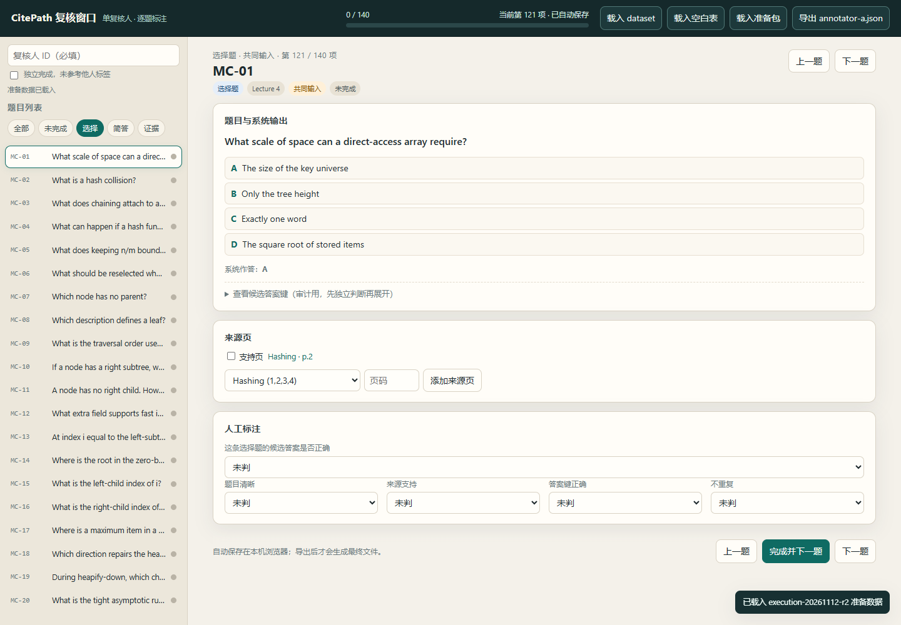

# CitePath 单复核人标注窗口

这是一个**纯静态浏览器窗口**：逐题填写 140 个人工标注项，自动保存在本机，最后导出 `annotator-a.json`。不需要后端、数据库或模型服务。

## 启动

从仓库根目录：

```powershell
python -m http.server 8765 --bind 127.0.0.1
```

浏览器打开：

```text
http://127.0.0.1:8765/tools/review-window/
```



默认自动载入 `evaluation_assets/cohorts/execution-20261112-r2` 的 `dataset.json` 和空白 `annotator-a.json`。

如果使用真实运行后合并出来的 `observed-dataset.json`，可以：

```text
http://127.0.0.1:8765/tools/review-window/?dataset=<url>&annotation=<url>
```

或者用页面右上角的 `载入 dataset` / `载入空白表` 文件选择器。`file://` 直接打开时浏览器会拦截自动载入，用文件选择器即可。

## 使用

1. 在左侧填复核人 ID，勾选“独立完成，未参考他人标签”。
2. 逐题填写；顶部进度条显示完成数。
3. 每题填完点“完成并下一题”；拿不准的可以先留空。
4. 最后点“导出 annotator-a.json”；有未完成项时会确认是否导出部分标注。
5. 浏览器自动保存；刷新后恢复同一 dataset SHA 的进度。

## 题型

- **选择题**：候选答案正确性、支持页、题目审计（清晰、来源支持、答案键、不重复）。候选答案键默认折叠，先独立判断再看。
- **简答题**：勾选 rubric 命中索引（从 0 开始）、支持页、题目审计。5 点中 4 点通过，3 点不通过。
- **证据问答**：问题是否被支持、答案正确性、参考点覆盖、claim 完整性、每条 claim 的支持判断、无关引用。`baseline` 和 `full` 分开标注。
- 准备数据的 `predictions` 为 `null`，因此证据题的 claim 区域会提示“需要 observed-dataset.json”；这是正常的，不是页面错误。

## 边界

- 该窗口只负责**人工标注**；不计算正式指标，不设置 `official_accepted`。
- 单人复核只能在课程批准下作为单复核人报告；不能当成两位独立复核的一致率结果。
- 不要用 AI 预标注或复制别人的表；`label_origin` 只会导出为 `human`，独立性由复核人自己确认。
- 导出的 JSON 只包含标注，不含密码、Cookie 或模型密钥。
